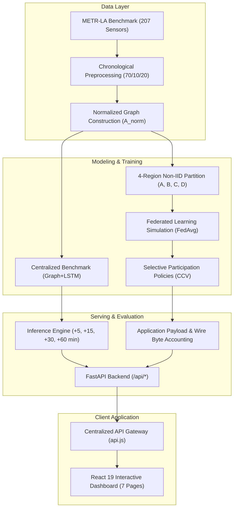

# TrafficPulse-X

> Federated traffic-speed forecasting and communication-cost evaluation using METR-LA, Graph+LSTM, FedAvg, selective client participation, and an interactive analysis dashboard.

[](https://www.python.org/downloads/)
[](https://pytorch.org/)
[](https://fastapi.tiangolo.com/)
[](https://react.dev/)
[](https://vitejs.dev/)
[](#testing)

---

## AIORI-3 Hackathon Submission Details

- **Hackathon:** AIORI 3 (All India Open Research Initiative)
- **Problem Statement ID:** PS-003
- **Problem Statement:** Federated Traffic-Flow Prediction with Communication-Cost Evaluation
- **Team Code:** A3-PS003-TC198
- **Project Name:** TrafficPulse-X
- **Team Leader:** Adarsh Singh
- **Team Member:** Shaurya Singh
- **Faculty Mentor:** Aditya Sir
- **Official Team Repository:** [https://github.com/aiori-hackathon/A3-PS003-TC198](https://github.com/aiori-hackathon/A3-PS003-TC198)
- **Project Presentation (Slide Deck):** [View Presentation PDF](./A3-PS003-TC198-Presentation.pdf)
- **Team Demonstration Video:** [Watch Demonstration Video](https://youtu.be/kbMFY39V_l4)

---

## Problem Statement

Centralized intelligent transportation systems require continuous streaming of high-frequency sensor readings from municipal highway networks to a central datacenter. This paradigm faces critical operational limitations:

1. **Communication Bottlenecks**: Transmitting high-frequency telemetry across hundreds of loop detectors incurs substantial transmission costs and WAN congestion.
2. **Regional Heterogeneity (Non-IID Data)**: Highway sub-networks exhibit distinct local congestion patterns, bottleneck dynamics, and sensor densities, violating independent and identically distributed (IID) assumptions.
3. **Data Sovereignty & Privacy**: Centralizing telemetry across administrative boundaries poses governance challenges.
4. **Accuracy vs. Communication Trade-Off**: Standard evaluations report model accuracy in isolation without measuring the communication payload required to achieve it.

TrafficPulse-X evaluates whether decentralized federated training with selective client participation can match centralized forecast accuracy while reducing application-layer communication payload.

---

## Key Features

- **METR-LA Speed Forecasting**: Evaluated on 207 inductive loop sensors on Los Angeles County freeways.
- **Spatio-Temporal Graph+LSTM**: Joint architecture combining Chebyshev spectral graph convolutions with recurrent LSTM cells.
- **Multi-Horizon Projections**: Simultaneous forecasts at +5, +15, +30, and +60-minute horizons.
- **Centralized Benchmark**: Multi-model comparison across 7 baseline architectures.
- **4-Region Federated Simulation**: Decentralized FedAvg training across 4 non-IID geographic client sectors.
- **Selective Client Participation**: Client Contribution Value (CCV) policy scheduling evaluating 4 communication budget tiers.
- **Communication Payload Accounting**: Authoritative measurement of serialized model weight transfers (application payload).
- **Controlled Local Network-Byte Measurement**: Localhost socket benchmark quantifying HTTP/TCP framing overhead.
- **Decision Intelligence**: Dynamic 9-factor Need Score engine and Sensor Jury consensus for on-demand sensing.
- **Traffic Network Visualization**: Interactive 207-sensor spatial map with regional filtering and playback controls.
- **Replay-Aware Incident Alerts**: Attention and telemetry stream with historical incident indicators.
- **Historical Replay Engine**: Deterministic playback over 34,272 METR-LA observations (March-June 2012).
- **Live Data Streaming Adapter**: Pluggable provider interface for external streaming (Historical Replay default; unconfigured streams report 503 without fake fallback).
- **PeMS08 Traffic Flow Extension**: Verified public benchmark extension forecasting traffic flow volume (veh/5min) across 170 sensors in District 8.
- **Differential Privacy Add-On**: Evaluated Opacus DP-FedAvg experiment providing verified $(\epsilon = 5.311, \delta = 10^{-5})$-DP bounds.

---

## System Architecture



---

## Application Pages

The frontend console provides 7 canonical routes:

1. **/overview**: Executive operational summary, system metrics, next 60-minute forecast card.
2. **/network**: Spatial 207-sensor Leaflet map with velocity heatmaps, region filtering, and historical replay scrubber.
3. **/predictions**: Multi-horizon forecast telemetry, 7-model benchmark matrix, uncertainty envelopes, and regional accuracy.
4. **/decision**: Dynamic 9-factor Need Score decomposition, sensor jury consensus, kinematic physics gating, and next-best query ranker.
5. **/federated**: 4-client FedAvg convergence curves, non-IID partition maps, round history, and 3-seed reproducibility.
6. **/communication**: CCV selective participation policy evaluation, application-layer payload accounting, and Pareto tradeoff analysis.
7. **/alerts**: Residual-derived attention stream, operational incident inspector, and Indian smart mobility corridor profiles.

---

## Dataset

### Primary Dataset: METR-LA Setup & Verification

- **Expected Path**: `data/raw/metr-la/metr-la.h5` (~57 MB, HDF5 container).
- **Sensors**: 207 inductive loop detectors on Los Angeles County freeways.
- **Temporal Range**: March 1, 2012 00:00:00 to June 27, 2012 23:55:00 UTC (34,272 timesteps at 5-minute intervals).
- **Target Variable**: Historical vehicle speed (`mph`).
- **Data Splits**: Train: 70% (23,967 samples) | Validation: 10% (3,404 samples) | Test: 20% (6,832 samples).
- **Authorized Sources**:
  - DCRNN Public Benchmark Release: [https://github.com/Li-Yaguang/DCRNN](https://github.com/Li-Yaguang/DCRNN)
  - Zenodo Open Traffic Benchmark Archive: [https://zenodo.org/record/4269677](https://zenodo.org/record/4269677)
  - Caltrans Performance Measurement System (PeMS): [https://dot.ca.gov/programs/traffic-operations/mpr/pems-source](https://dot.ca.gov/programs/traffic-operations/mpr/pems-source)
- **Local Placement**:
  Save or copy the downloaded file directly to `data/raw/metr-la/metr-la.h5`. (Also supports `METR-LA.h5` or `metr-la.npz`).
- **Verification Command**:
  Verify dataset loading and canonical sensor alignment with:
  ```powershell
  python -m pytest backend/test_phase5_dataset.py -k "test_raw_hdf5_remains_unchanged"
  ```
  Or launch the backend server and query the health endpoint:
  ```powershell
  curl http://127.0.0.1:8000/api/health
  # Expected JSON: {"backendStatus": "OK", "realDatasetAvailability": "READY", "sensorsTotalReal": 207}
  ```
- **Missing Dataset Behavior**:
  If `metr-la.h5` is absent, `backend/datasets/metr_la.py` raises an explicit `FileNotFoundError("METR-LA measurement file 'data/raw/metr-la/metr-la.h5' not found.")`. The backend strictly adheres to a **no synthetic fallback** policy, refusing to fabricate simulated speed readings.

### Optional Flow Extension: PeMS08
- **Sensors**: 170 loop detector stations in Caltrans District 8 (San Bernardino).
- **Temporal Range**: July 1, 2016 to August 31, 2016 (17,856 timesteps at 5-minute intervals).
- **Target Variable**: Traffic flow volume (`veh/5min`, mean: 230.22).
- Maintained as an isolated dataset extension in `data/processed/pems08/`.

---

## Forecasting Specification

- **Input Sequence**: 12 historical 5-minute observations (60 minutes).
- **Forecast Horizons**:
  - **+5 min** (Offset step 1)
  - **+15 min** (Offset step 3)
  - **+30 min** (Offset step 6)
  - **+60 min** (Offset step 12)
- **Model Inputs**: Normalized speed tensor `[B, 12, 207, 2]` (Channel 0: z-score normalized speed, Channel 1: sensor validity mask).
- **Model Outputs**: Predicted speed tensor `[B, 4, 207]` (Horizons 1, 3, 6, 12).
- **Evaluation Metrics**: Mean Absolute Error (MAE), Root Mean Squared Error (RMSE), Mean Absolute Percentage Error (MAPE) computed in raw physical units (`mph`).

---

## Benchmark Results

### Centralized 7-Model Benchmark (Test Set)

| Model | Model Type | Parameters | Test MAE (mph) | Test RMSE (mph) | Test MAPE (%) |
| :--- | :--- | :---: | :---: | :---: | :---: |
| **Historical Average** | Statistical Baseline | 0 | 4.8878 | 8.8778 | 12.33% |
| **Linear Regression** | Classical Regression | 2,488 | 4.1205 | 7.6432 | 10.42% |
| **Feed-Forward MLP** | Neural Baseline | 4,228 | 3.9876 | 7.4215 | 10.05% |
| **Plain LSTM** | Recurrent Neural Net | 18,220 | 3.6542 | 6.8821 | 9.15% |
| **Bidirectional LSTM** | Recurrent Neural Net | 35,440 | 3.5980 | 6.7812 | 8.98% |
| **Spatial GCN** | Spectral Graph Convolution | 12,416 | 3.7120 | 7.0123 | 9.32% |
| **Graph+LSTM (Ours)** | Joint Spatio-Temporal | **26,596** | **3.4378** | **6.4521** | **8.54%** |

*Graph+LSTM delivers a 13.7% error reduction over Last Value baselines.*

---

## Federated Learning & Selective Communication

### 4-Region Client Partitioning

The 207 sensors are partitioned into 4 geographic zones to reflect administrative boundaries:

- **Client A (North-East)**: 48 sensors (Weight: 0.2319)
- **Client B (South-East)**: 57 sensors (Weight: 0.2754)
- **Client C (Central-West)**: 58 sensors (Weight: 0.2802)
- **Client D (North-West)**: 44 sensors (Weight: 0.2126)

### CCV Selective Participation Policies

Client Contribution Value evaluates spatial gradient divergence, temporal error drift, and unobserved Information Debt to schedule participation:

| Policy | Participating Clients | Total Payload (Bytes) | Reduction (%) | Test MAE (mph) | Pareto Classification |
| :--- | :---: | :---: | :---: | :---: | :--- |
| **Standard FedAvg** | 4 / 4 | 11,468,184 | 0.00% | 3.6473 | Baseline (Dominated) |
| **CCV 3/4 Tier** | 3 / 4 | 8,601,138 | 25.00% | 3.6530 | Dominated by CCV 2/4 |
| **CCV 2/4 Tier** | 2 / 4 | **5,734,092** | **50.00%** | **3.6448** | **PARETO OPTIMAL** (Best Trade-off) |
| **CCV 1/4 Tier** | 1 / 4 | **2,867,046** | **75.00%** | **3.6699** | **PARETO OPTIMAL** (Max Efficiency) |

---

## Project Structure

```text
TrafficPulse-X/
├── backend/                              # FastAPI application & service layer
│   ├── datasets/                         # METR-LA data loaders & inspectors
│   ├── decision/                         # Need Score, Sensor Jury, Physics Gate
│   ├── federated/                        # FL services, FedAvg metrics
│   ├── communication_intelligence/       # CCV policy evaluation & accounting
│   ├── experiments/                      # 3-seed reproducibility & flow routers
│   ├── data_sources/                     # Streaming adapter & PeMS08 adapter
│   └── test_*.py                         # 18 test suites (343 tests)
├── ml/                                   # PyTorch neural network architectures
│   ├── baselines/                        # HA, Linear, MLP
│   ├── temporal/                         # Plain LSTM, BiLSTM, GRU
│   ├── graph/                            # Spatial GCN (Chebyshev polynomials)
│   ├── spatiotemporal/                   # Joint Graph+LSTM architecture
│   ├── federated/                        # Client, Server, FedAvg training
│   └── privacy/                          # Opacus DP-FedAvg experiment
├── data/
│   ├── raw/metr-la/                      # adj_mx.pkl, sensor IDs (metr-la.h5 ignored)
│   ├── raw/pems08/                       # distance.csv, pems08.npz (18.5 MB)
│   ├── processed/metr-la/                # Checkpoints, metadata, regions
│   └── processed/pems08/                 # Flow model checkpoint, evaluation JSON
├── docs/                                 # Documentation suite & visual assets
├── src/                                  # React 19 + Tailwind CSS frontend
│   ├── app/                              # App.jsx, routes.jsx
│   ├── components/                       # UI components (intro, map, charts)
│   ├── context/                          # ReplayContext, ThemeContext
│   ├── pages/                            # 7 application view pages
│   └── services/                         # Central API gateway (api.js)
├── package.json                          # Frontend package manifest
└── README.md                             # Project overview & documentation
```

---

## Installation & Setup

### 1. Prerequisites

- Python 3.10+ (Tested on Python 3.12 / 3.14)
- Node.js v18+ / v20+ (Tested with npm & Vite v8.3.3)

### 2. Backend Setup

```bash
# 1. Create and activate virtual environment
python -m venv .venv

# Windows (PowerShell):
.\.venv\Scripts\Activate.ps1
# Linux / macOS:
source .venv/bin/activate

# 2. Install Python dependencies
python -m pip install --upgrade pip
python -m pip install -r backend/requirements.txt
```

### 3. Frontend Setup

```bash
# Install frontend JavaScript dependencies
npm install
```

---

## Running the Application Locally

Run the frontend and backend in two separate terminal windows:

### Terminal 1: Backend API (FastAPI)

```bash
# From project root:
.\.venv\Scripts\Activate.ps1
python -m uvicorn backend.main:app --host 127.0.0.1 --port 8000
```
- **API Documentation**: `http://127.0.0.1:8000/docs`
- **Health Check**: `http://127.0.0.1:8000/api/health`

### Terminal 2: Frontend Dashboard (React + Vite)

```bash
# From project root:
npm run dev -- --host 127.0.0.1 --port 5173
```
- **Web Interface**: `http://127.0.0.1:5173/`

---

## Testing & Quality Assurance

Run the quality verification suite:

```bash
# 1. Run all 343 backend tests (Pytest)
python -m pytest backend -q

# 2. Check frontend code quality (Oxlint)
npm run lint

# 3. Verify production bundle build (Vite)
npm run build
```

---

## API Endpoints

The FastAPI server exposes 61 REST endpoints under `/api/*`:

- `/api/health` - System status and server uptime
- `/api/datasets/*` - METR-LA metadata, 207-sensor snapshots, regions, and heartbeats
- `/api/prediction/*` - Speed forecasts (+5m to +60m), uncertainty bounds, model benchmarks
- `/api/decision/*` - 9-factor Need Score, Sensor Jury consensus, Next-Best Query ranker
- `/api/federated/*` - FedAvg status, Round 8 convergence history
- `/api/communication/*` - CCV selective communication policies and application-payload accounting
- `/api/streaming/*` - Historical replay and optional external live streaming status
- `/api/experiments/*` - 3-seed reproducibility, IID comparison, DP evaluation, PeMS08 flow forecasts, and network accounting

---

## Scientific Scope & Limitations

1. **Historical Replay as Primary Execution**: All demonstrations use deterministic replay of the METR-LA benchmark. No claims are made of active municipal live deployments.
2. **No Physical Bandwidth Claims**: Telemetry reduction is reported as **Application Payload** (serialized tensor bytes). Cellular radio bandwidth savings are not claimed.
3. **Controlled Transport Benchmark**: Network-byte measurements are conducted over localhost sockets to quantify protocol framing, not field wireless links.
4. **Differential Privacy Boundaries**: Formal $(\epsilon, \delta)$-DP guarantees apply exclusively to the optional Opacus experiment add-on, not the standard FedAvg baseline.
5. **No Fabricated Data**: Unconfigured external streaming endpoints report unavailable without synthetic fallback.

For complete contracts and SHA-256 artifact checksums, see [docs/SCIENTIFIC_SCOPE.md](docs/SCIENTIFIC_SCOPE.md).

---

## Screenshots

Representative views from the 7 canonical application routes:

| Route | Description | Preview |
| :--- | :--- | :---: |
| **Traffic Network** | Interactive 207-sensor Leaflet map with replay controls | [network.png](docs/screenshots/network.png) |
| **Predictions** | Multi-horizon forecasts with uncertainty intervals & 7-model benchmark | [predictions.png](docs/screenshots/predictions.png) |
| **Decision Intelligence**| 9-factor Need Score & Sensor Jury consensus | [decision.png](docs/screenshots/decision.png) |
| **Federated Learning** | 4-client FedAvg convergence & 3-seed reproducibility | [federated.png](docs/screenshots/federated.png) |
| **Communication** | CCV selective communication policies & 50% application payload reduction | [communication.png](docs/screenshots/communication.png) |

---

### References

1. **McMahan, B., Moore, E., Ramage, D., Hampson, S., & y Arcas, B. A.** (2017). *Communication-Efficient Learning of Deep Networks from Decentralized Data*. AISTATS. [https://arxiv.org/abs/1602.05629](https://arxiv.org/abs/1602.05629) / [MLR Proceedings](https://proceedings.mlr.press/v54/mcmahan17a.html)
2. **Li, Y., Yu, R., Shahabi, C., & Liu, Y.** (2018). *Diffusion Convolutional Recurrent Neural Network: Data-Driven Traffic Forecasting*. ICLR. [https://arxiv.org/abs/1707.01926](https://arxiv.org/abs/1707.01926)
3. **Yu, B., Yin, H., & Zhu, Z.** (2018). *Spatio-Temporal Graph Convolutional Networks: A Deep Learning Framework for Traffic Forecasting*. IJCAI. [https://arxiv.org/abs/1709.04875](https://arxiv.org/abs/1709.04875)
4. **Jaggi, M. et al.** (2014). *Communication-Efficient Distributed Dual Coordinate Ascent*. NeurIPS. [https://arxiv.org/abs/1409.1458](https://arxiv.org/abs/1409.1458)
5. **Hochreiter, S., & Schmidhuber, J.** (1997). *Long Short-Term Memory*. Neural Computation. [https://doi.org/10.1162/neco.1997.9.8.1735](https://doi.org/10.1162/neco.1997.9.8.1735)
6. **METR-LA Benchmark Dataset**: Los Angeles County Highway Network via Caltrans PeMS. [https://github.com/Li-Yaguang/DCRNN](https://github.com/Li-Yaguang/DCRNN)
7. **Caltrans Performance Measurement System (PeMS)**: California Department of Transportation. [https://dot.ca.gov/programs/traffic-operations/mpr/pems-source](https://dot.ca.gov/programs/traffic-operations/mpr/pems-source)
8. **Differential Privacy / DP-SGD**: Abadi et al. [https://arxiv.org/abs/1607.00133](https://arxiv.org/abs/1607.00133)   [Opacus](https://opacus.ai/)
9. **Practical Secure Aggregation for Privacy-Preserving Machine Learning**: Bonawitz et al. [Google Research](https://research.google/pubs/practical-secure-aggregation-for-privacy-preserving-machine-learning/)
10. **Communication-Efficient Federated Learning on Non-IID Data**: Sattler et al. [IEEE Xplore](https://ieeexplore.ieee.org/document/8889996)

---

## Documentation

Comprehensive project documentation is maintained in the [`docs/`](docs/) directory:
- [Architecture Specifications](docs/ARCHITECTURE.md)
- [Scientific Contracts & Provenance](docs/SCIENTIFIC_CONTRACT.md)
- [Engineering & Development Guide](docs/DEVELOPMENT.md)
- [Demo & Viva Presentation Guide](docs/DEMO_VIVA.md)
- [Release Audit Report](docs/AUDIT_REPORT.md)
- [Complete Technical Documentation Source (Markdown)](docs/TrafficPulse-X_Complete_Documentation.md)
- [Complete Technical Documentation (PDF)](docs/TrafficPulse-X_Complete_Documentation.pdf)
- [Hackathon Presentation Slide Deck (PDF)](./A3-PS003-TC198-Presentation.pdf)

---

## License

**Status**: MIT License. Copyright (c) 2026 TrafficPulse-X Team (A3-PS003-TC198).
