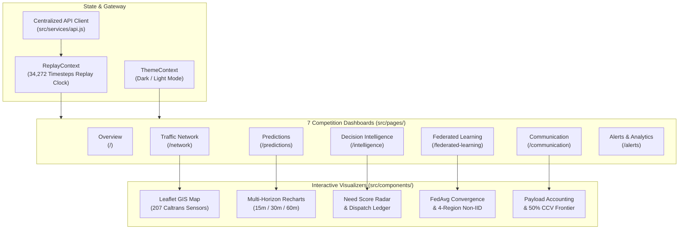

# TrafficPulse-X — Frontend Architecture & Component Guide

> High-performance React 19 dashboard powered by Tailwind CSS, Leaflet GIS, Recharts, and GPU-optimized anti-blur typography.

---

## 1. System Architecture & Component Dataflow

The frontend is built as a single-page application (SPA) centered around a synchronized historical telemetry clock (`ReplayContext`), feeding 7 distinct operational views.



---

## 2. Directory Structure

```text
src/
├── app/
│   └── App.jsx                           # Primary router, navigation layout & modals
├── pages/                                # 7 Core Application Dashboards
│   ├── Overview/Overview.jsx             # System KPI console & sector overview
│   ├── TrafficNetwork/TrafficNetwork.jsx # 207-sensor interactive GIS map
│   ├── Prediction/Prediction.jsx         # Multi-horizon forecast engine & benchmarks
│   ├── DecisionIntelligence/             # Need Score prioritization & action tiers
│   ├── FederatedLearning/                # 4-client FedAvg convergence & math proofs
│   ├── Communication/                    # 50% CCV savings & payload accounting
│   └── Alerts/Alerts.jsx                 # Anomaly thresholds & incident stream
├── components/                           # Modular Reusable Widgets
│   ├── common/                           # MetricCard, DataTable, ScientificBadge, Modals
│   ├── traffic/                          # RealTrafficMap, MapLegend, UnifiedMapControls
│   ├── prediction/                       # ForecastChartCard, ForecastHorizonCards
│   ├── decision/                         # CounterfactualQueryCard, EvidenceChain, NeedScore
│   ├── federated/                        # CentralizedVsFederated, PrivacyExperiment
│   ├── communication/                    # CommunicationBreakdownDonut, ParetoChart
│   └── alerts/                           # AlertStreamTable, SelectedAlertInspector
├── context/
│   ├── ReplayContext.jsx                 # Global time-tick & sensor telemetry state
│   └── ThemeContext.jsx                  # Dark/light theme persistence
├── data/
│   ├── sensor_location_names.json        # 207 authentic Caltrans freeway cross-points
│   └── replayAlertsData.js               # Synchronized offline incident stream
├── services/
│   └── api.js                            # Axios/Fetch client with dynamic VITE_API_URL
├── utils/
│   └── formatters.js                     # Formatting helpers for speed, bytes, and dates
├── index.css                             # Typography engine & anti-blur styling
└── main.jsx                              # React DOM mount point
```

---

## 3. Typography & Subpixel Anti-Blur Engine

To eliminate font blurriness on Windows and high-DPI displays:
- **DirectWrite ClearType Restoration**: Removed persistent `will-change: transform` and CSS 3D transforms on parent containers so Chromium preserves subpixel antialiasing.
- **Font Stack**: Dual modern font stack importing Google `Inter` for clean prose and `JetBrains Mono` for tabular numerals.
- **Stroke-Bleed Prevention**: Monospace numbers and IDs are capped at `font-weight: 600` (`font-bold`) to keep inner glyph counters sharp at small pixel sizes (10–12px).

---

## 4. Local Development Runbook

```bash
# 1. Install frontend dependencies
npm install

# 2. Start Vite local development server (Port 5173)
npm run dev

# 3. Compile optimized production build (Sub-2.5s)
npm run build

# 4. Preview compiled production bundle
npm run preview
```

---

## 5. Live Production Deployment
- **Live URL**: [https://trafficpulsex-frontend.onrender.com](https://trafficpulsex-frontend.onrender.com)
- **SPA Fallback**: Configured with `/* -> /index.html` rewrite rules to prevent 404s on browser refresh.
