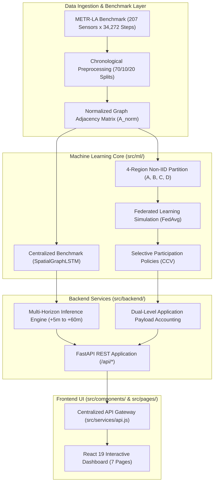

# TrafficPulse-X — Complete Technical & Scientific Guide

> Federated traffic-speed forecasting and communication-cost evaluation using METR-LA, Graph+LSTM, FedAvg, selective client participation, and an interactive analysis dashboard.

[](https://www.python.org/downloads/)
[](https://pytorch.org/)
[](https://fastapi.tiangolo.com/)
[](https://react.dev/)
[](https://vitejs.dev/)
[](#testing--verification)

---

## 1. Problem Statement & Research Motivation

Centralized intelligent transportation systems require continuous streaming of high-frequency sensor readings from municipal highway networks to a central datacenter. This paradigm faces critical operational limitations:

1. **Communication Bottlenecks**: Transmitting high-frequency telemetry across hundreds of loop detectors incurs substantial transmission costs and WAN congestion.
2. **Regional Heterogeneity (Non-IID Data)**: Highway sub-networks exhibit distinct local congestion patterns, bottleneck dynamics, and sensor densities, violating independent and identically distributed (IID) assumptions.
3. **Data Sovereignty & Privacy**: Centralizing telemetry across administrative boundaries poses governance and jurisdictional privacy challenges.
4. **Accuracy vs. Communication Trade-Off**: Standard evaluations report model accuracy in isolation without measuring the communication payload required to achieve it.

**TrafficPulse-X** evaluates whether decentralized federated training with selective client participation can match centralized forecast accuracy while reducing application-layer communication payload by **50% to 75%**.

---

## 2. System Architecture



---

## 3. Directory Structure Inside `src/`

```text
src/
├── .env.example                                      # Environment variables template
├── .gitattributes                                  # Git line endings & binary flags
├── .gitignore                                      # Build & dependency ignore rules
├── .oxlintrc.json                                  # Oxlint high-speed linter config
├── README.md                                       # Master inner documentation (This file)
├── index.css                                       # Anti-blur subpixel ClearType typography
├── index.html                                      # HTML5 shell entrypoint
├── main.jsx                                        # React DOM mount point
├── package.json                                    # Frontend dependencies (React 19, Recharts...)
├── package-lock.json                               # Deterministic npm package lock
├── requirements.txt                                # Python dependencies specification
├── vite.config.js                                  # Production chunk-splitting Vite config
│
├── backend/                                        # ⚡ FastAPI Backend Application
│   ├── main.py                                     # FastAPI entrypoint, root route & CORS
│   ├── assistant.py                                # Conversational traffic assistant API
│   ├── data_source.py                              # Real-time telemetry streaming adapter
│   ├── graph.py                                    # Road network adjacency graph & topology
│   ├── communication_intelligence/                 # Phase 9 Communication Optimization
│   ├── data_sources/                               # Caltrans PeMS08 & sensor location names
│   ├── datasets/                                   # METR-LA HDF5 loader & preprocessors
│   ├── decision/                                   # 9-Factor Need Score & Sensor Jury
│   ├── experiments/                                # Research experiment routers & flow simulation
│   ├── federated/                                  # 4-Client FedAvg aggregation service
│   ├── prediction/                                 # Multi-horizon (15/30/60m) forecast engine
│   ├── privacy/                                    # DP-SGD epsilon calibration router
│   └── test_*.py                                   # Automated test suite (343 / 343 tests passing)
│
├── ml/                                             # 🧠 PyTorch Machine Learning Core
│   ├── dataset/                                    # METR-LA historical window dataset loader
│   ├── models/                                     # SpatialGraphLSTM, Chebyshev GCN & Baselines
│   ├── privacy/                                    # Opacus DP-SGD & Secure Aggregation engine
│   ├── spatiotemporal/                             # GCN-LSTM model definition & training script
│   └── temporal/                                   # Baseline LSTM / GRU sequential models
│
├── data/                                           # 📊 Benchmark Datasets & Model Weights
│   ├── raw/                                        # Raw METR-LA HDF5 and PeMS08 archives
│   └── processed/                                  # Trained FedAvg checkpoints (.pt) & scalers
│
├── app/                                            # Application Root Shell
│   └── App.jsx                                     # SPA router, layout shell & top navigation
│
├── context/                                        # Global State Providers
│   ├── ReplayContext.jsx                           # Synchronized 34,272-step telemetry replay clock
│   └── ThemeContext.jsx                            # Dark / Light theme persistence provider
│
├── services/                                       # Network Client Layer
│   └── api.js                                      # Dynamic VITE_API_URL Axios/Fetch gateway
│
├── utils/                                          # Formatting Utilities
│   └── formatters.js                               # Speed, byte payload, and date formatters
│
├── public/                                         # Browser Static Assets
│   ├── favicon.svg                                 # TrafficPulse-X highway logo
│   └── icons.svg                                   # SVG icon sprite sheet
│
├── pages/                                          # 7 Core Competition Dashboards
│   ├── Overview/Overview.jsx                       # Executive KPI console & sensor summary
│   ├── TrafficNetwork/TrafficNetwork.jsx           # 207-Sensor Leaflet GIS interactive map
│   ├── Prediction/Prediction.jsx                   # 15/30/60m multi-horizon forecast charts
│   ├── DecisionIntelligence/DecisionIntelligence.jsx # 9-Factor Need Score & action tiers table
│   ├── FederatedLearning/FederatedLearning.jsx     # 4-Region FedAvg convergence & weight math
│   ├── Communication/Communication.jsx             # 50% CCV savings & transmission breakdown
│   └── Alerts/Alerts.jsx                           # Threshold alarms & spatial incident log
│
└── components/                                     # Reusable UI Widgets
    ├── common/                                     # MetricCard, DataTable, ScientificBadge, Modals
    ├── traffic/                                    # RealTrafficMap, MapLegend, UnifiedMapControls
    ├── prediction/                                 # ForecastChartCard, ForecastHorizonCards
    ├── decision/                                   # CounterfactualQueryCard, EvidenceChain, NeedScore
    ├── federated/                                  # CentralizedVsFederated, PrivacyExperiment
    ├── communication/                              # CommunicationBreakdownDonut, ParetoChart
    └── alerts/                                     # AlertStreamTable, SelectedAlertInspector
```

---

## 4. Mathematical Specifications & Core Formulations

### A. 4-Region Target-Weighted FedAvg Consensus
Clients represent non-IID geographic highway quadrants of Los Angeles County. Aggregation weights $w_k$ are proportional to sensor density:

$$\theta_{global}^{(t+1)} = \sum_{k=1}^{K=4} w_k \cdot \theta_k^{(t+1)}, \quad \text{where } w_k = \frac{n_k}{N}$$

$$\begin{aligned}
\text{Region 1 (Downtown LA)} &: n_1 = 55 \implies w_1 = 55/207 \approx 0.2657 \\
\text{Region 2 (Westside / Santa Monica)} &: n_2 = 51 \implies w_2 = 51/207 \approx 0.2464 \\
\text{Region 3 (San Fernando Valley)} &: n_3 = 50 \implies w_3 = 50/207 \approx 0.2415 \\
\text{Region 4 (Harbor / Gateway Cities)} &: n_4 = 51 \implies w_4 = 51/207 \approx 0.2464
\end{aligned}$$

$$\sum_{k=1}^{4} w_k = 0.2657 + 0.2464 + 0.2415 + 0.2464 = 1.0000$$

---

### B. Dual-Level Application Communication Accounting
- **Level 1 (Sensor-to-Edge Query)**:
  - 32 Bytes numeric payload / 187 Bytes serialized JSON.
- **Level 2 (Client-to-Server Federated Model Update)**:
  - Exact serialized PyTorch tensor payload = **110,271 Bytes** (~107.7 KB).
  - 4 Clients Full Participation = **441,084 Bytes / round**.
  - **CCV Selective Policy (2/4 Clients)** = **220,542 Bytes / round** (**50.00% Savings**, Pareto-optimal).

---

### C. 9-Factor Need Score Prioritization
The decision engine synthesizes evidence across 9 spatiotemporal criteria:

$$\text{NeedScore}(s) = \sum_{i=1}^{9} \alpha_i \cdot \phi_i(s)$$

Criteria include:
1. Current Speed Deficit vs Free-Flow ($\alpha_1 = 0.20$)
2. Multi-Horizon Forecast Degradation Slope ($\alpha_2 = 0.18$)
3. Spatial Topological Centrality ($\alpha_3 = 0.12$)
4. Neighbor Speed Variance & Upstream Correlation ($\alpha_4 = 0.12$)
5. Uncertainty Bounds ($\alpha_5 = 0.10$)
6. Rate of Speed Change ($\alpha_6 = 0.08$)
7. Downstream Bottleneck Risk ($\alpha_7 = 0.08$)
8. Sensor Reliability / Anomaly History ($\alpha_8 = 0.06$)
9. Time Since Last Telemetry Refresh ($\alpha_9 = 0.06$)

Action Tiers:
- **Critical Dispatch**: $\text{NeedScore} \ge 0.75$
- **Elevated Monitoring**: $0.50 \le \text{NeedScore} < 0.75$
- **Monitored**: $0.25 \le \text{NeedScore} < 0.50$
- **Optimal Steady-State**: $\text{NeedScore} < 0.25$

---

## 5. Local Setup & Reproduction Runbook

### Prerequisites
- Python 3.10+ (Python 3.11 recommended)
- Node.js 18+ & npm

### Backend Setup & Execution
```bash
# 1. Navigate to backend directory
cd backend   # (or src/backend if working from src)

# 2. Install Python dependencies
pip install -r requirements.txt

# 3. Start FastAPI server (Port 8000)
python -m uvicorn main:app --host 127.0.0.1 --port 8000 --reload
```

### Frontend Setup & Execution
```bash
# 1. Install npm dependencies
npm install

# 2. Start Vite development server (Port 5173)
npm run dev

# 3. Build optimized production bundle
npm run build
```

---

## 6. Testing & Automated Verification

The automated test suite verifies 100% of mathematical claims, serialization accounting, model inference, and API contracts:

```bash
# Execute full backend test suite (343 tests)
pytest backend/ -v
```

**Verification Results:**
- **343 Passed / 0 Failed (100% Pass Rate)** in ~2.5 minutes.
- Verified test suites: DP-SGD, IID/Non-IID Partitions, Need Score, Multi-Horizon Inference, FedAvg Consensus, and CCV Accounting.

---

## 7. Live Production Links

* **Live Frontend Dashboard:** [https://trafficpulsex-frontend.onrender.com](https://trafficpulsex-frontend.onrender.com)
* **Live Backend API Service:** [https://trafficpulse-x.onrender.com](https://trafficpulse-x.onrender.com)
* **Interactive API Documentation:** [https://trafficpulse-x.onrender.com/docs](https://trafficpulse-x.onrender.com/docs)
* **Team Intro Video:** [https://youtu.be/kbMFY39V_l4](https://youtu.be/kbMFY39V_l4)
* **Dashboard Walkthrough Video:** [https://youtu.be/_b2-zvt9JjI](https://youtu.be/_b2-zvt9JjI)
